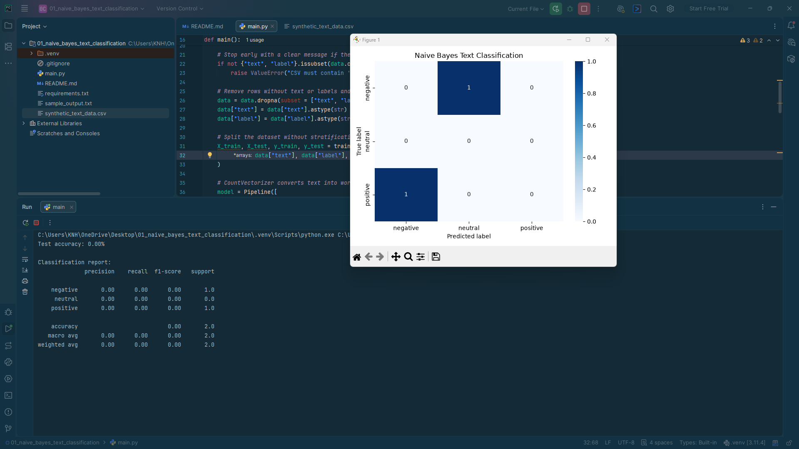
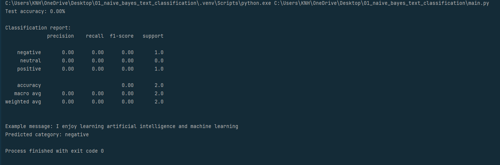

# Naive Bayes Text Classification

A beginner-friendly text-classification project that converts messages into word-count features and trains a **Multinomial Naive Bayes** classifier. It demonstrates a traditional machine-learning workflow from reading a labelled CSV through model evaluation and predicting a new message.

## Overview

Text data cannot be passed directly into a traditional scikit-learn classifier as raw sentences. This project uses `CountVectorizer` to build a vocabulary and represent each message as a sparse vector of word counts, then uses `MultinomialNB` to learn the relationship between those counts and the target labels.

## Learning Objectives

- Load and validate a CSV dataset with pandas.
- Separate examples into training and test sets.
- Convert natural-language text into numeric word-count features.
- Combine preprocessing and model training in a scikit-learn `Pipeline`.
- Evaluate predictions with accuracy, precision, recall, F1-score, and a confusion matrix.
- Use the fitted pipeline to classify a new sentence.

## Technology Stack

- **Python** — application language
- **pandas** — CSV loading and data cleaning
- **scikit-learn** — data splitting, `CountVectorizer`, `MultinomialNB`, `Pipeline`, and metrics
- **Matplotlib / Seaborn** — confusion-matrix visualization

## Dataset

Place `synthetic_text_data.csv` in the same folder as `main.py`.

Required columns:

| Column | Description | Example |
|---|---|---|
| `text` | The message or sentence to classify | `I enjoy learning machine learning` |
| `label` | The target category for that row | `technology`, `spam`, or another label used consistently in your dataset |

The script expects at least two target classes and enough examples for a stratified train/test split. The dataset is supplied by the user; it is not generated by the script. Use a dataset with representative, correctly labelled examples. If the supplied file is synthetic, describe it as synthetic in your portfolio rather than presenting its metrics as real-world performance.

## Methodology

1. Read `synthetic_text_data.csv` with pandas.
2. Verify that `text` and `label` columns exist.
3. Remove rows with missing values and convert the fields to strings.
4. Create an **80/20 stratified train/test split** with `random_state=42`.
5. Run `CountVectorizer` to create word-count features.
6. Train `MultinomialNB` inside a scikit-learn `Pipeline`.
7. Evaluate the held-out test messages.
8. Display the confusion matrix as a heatmap.
9. Predict the category of a sample sentence.

## Model Details

| Component | Role |
|---|---|
| `CountVectorizer` | Learns the vocabulary from training text and represents each message using word counts. |
| `MultinomialNB` | Estimates class probabilities from word-count features. |
| `Pipeline` | Keeps feature extraction and classification connected, reducing the risk of inconsistent preprocessing at prediction time. |

The pipeline does not perform advanced semantic understanding, embeddings, or deep learning. It is intentionally small so the effect of text vectorization and a classical classifier is easy to study.

## Evaluation

The script prints:

- **Test accuracy** — the overall fraction of test predictions that are correct.
- **Classification report** — precision, recall, F1-score, and support for each label.
- **Confusion matrix heatmap** — a visual count of correct and incorrect predictions for each class.
- **Example prediction** — the label predicted for a new sample sentence.

Exact results depend on the dataset, class balance, and the train/test split. No fixed accuracy value is guaranteed. The current script displays the trained pipeline and chart but does **not** save the fitted classifier to disk.

## Installation and Execution

Run these commands in PowerShell from this project folder:

```powershell
python -m venv .venv
.\.venv\Scripts\Activate.ps1
python -m pip install -r requirements.txt
python main.py
```

If you already have an activated virtual environment, you can install the requirements and run `python main.py` directly.

## Project Files

| File | Purpose |
|---|---|
| `main.py` | Loads the CSV, trains the pipeline, evaluates predictions, plots the confusion matrix, and classifies a sample sentence. |
| `requirements.txt` | Lists the Python packages required by the script. |
| `synthetic_text_data.csv` | User-supplied labelled dataset; keep it beside `main.py`. |
| `screenshot/output.png` | Screenshot of the actual program output or visualization. |

## Output Screenshot




*The image above is loaded from `screenshot/output.png`. Keep the screenshot at that relative path so it renders on GitHub.*

## Limitations

- Performance depends on the size, quality, and representativeness of the supplied dataset.
- Word counts do not capture word order or deeper semantic meaning.
- Rare words and vocabulary differences can affect predictions.
- The script does not persist the fitted model, provide a command-line interface, or expose a web API.
- A held-out test score is an estimate, not proof that the model will perform equally well on future messages.

## Possible Next Steps

- Compare `CountVectorizer` with `TfidfVectorizer`.
- Try another classical model such as Logistic Regression.
- Add cross-validation and save a measured comparison table.
- Add a model-saving step and a separate prediction script once the fundamentals are understood.

**Project level:** Junior · Classical Machine Learning · Text Classification

# Moe Htet Ar Kar (Phoe Cho)